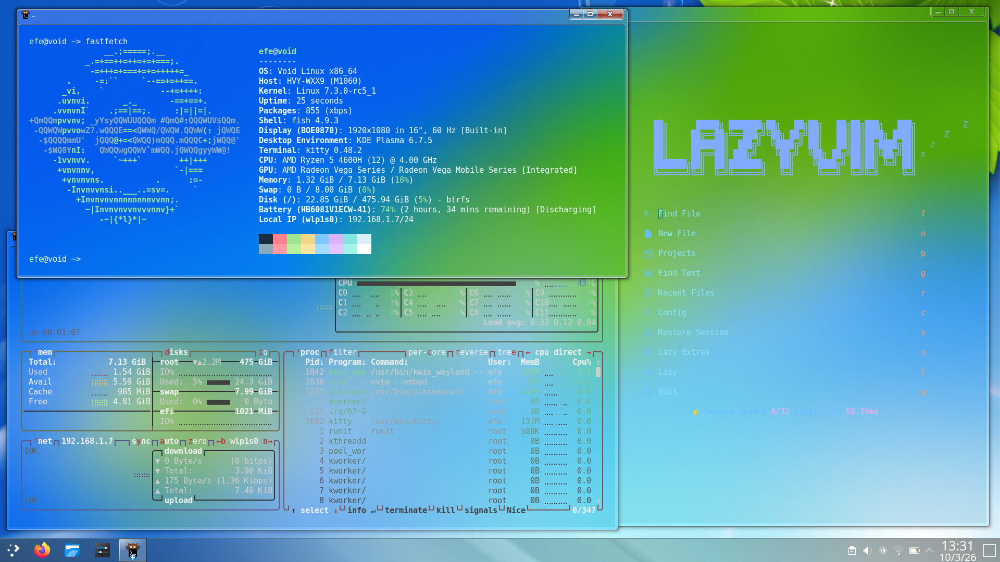

# Glass Aero



## Kurulum

**KDE Plasma 6** oturumunda paket klasörünü açın:

```sh
sh install.sh
```

Script önce yedek alır, eksik Kvantum/Aurorae paketlerini otomatik kurar ve yüklenmelerini doğrular. Paket kurulumu gerekirse yönetici parolası ister. Kitty, Fish ve Firefox kurulmaz veya değiştirilmez.

Kitty'nin mavi cam ayarları ve ayrı elle kurulum rehberi: [kitty/README.md](kitty/README.md).

Oturumu kapatıp açın. Tema **Sistem Ayarları → Global Tema → Glass Aero** olarak görünür. İsterseniz masaüstü düzenini de seçerek altta 46 px panel ve ikon aralığı 3 olan düzeni uygulayın.

Kaldırmak için `sh uninstall.sh` çalıştırın; kurulum öncesi görünüm ayarları geri yüklenir. Ek hareket bulanıklığı isteğe bağlıdır: **Masaüstü Efektleri → Glass Aero: Keep Blur**.

Otomatik bağımlılık kurulumu: XBPS, APT, Pacman, DNF, Zypper, APK, Portage ve Nix. Atomic/rpm-ostree sistemlerde paket kurulumu sonrasında yeniden başlatıp scripti tekrar çalıştırın. Plasma 5 desteklenmez. Test kapsamı: [COMPATIBILITY.md](COMPATIBILITY.md).
